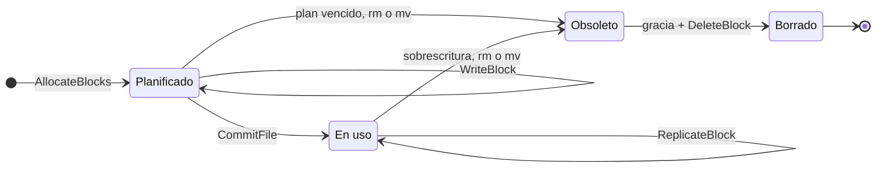

# DFSha: arquitectura P2P con superpeers

Referencia técnica de la arquitectura de DFSha: qué hace cada componente, cómo se comunican y por
qué se diseñó así. El informe técnico resume este documento y remite aquí para los detalles.
La especificación exacta de la API es [`dfsha/proto/dfsha.proto`](../dfsha/proto/dfsha.proto).
Los diagramas de la arquitectura y de los flujos principales están en la
[wiki del proyecto](https://github.com/eaz03/dfSHA-SistemasDistribuidos/wiki/Arquitectura).

## 1. Vista general

DFSha es un sistema de archivos distribuido **basado en bloques**, organizado como una red
**P2P híbrida con superpeers**:

- Los **peers** guardan los bloques de los archivos. Cada archivo se parte en bloques de tamaño fijo
  y cada bloque se replica en varios peers.
- Los **superpeers** guardan solo los **metadatos**: qué archivos y directorios existen, de qué
  bloques está hecho cada archivo y en qué peers está cada bloque. También llevan la tabla de peers
  vivos y los usuarios. Forman entre ellos una **federación**: cada uno tiene una copia completa del
  registro y es el dueño de un grupo de usuarios.
- Los **clientes** montan DFSha como una carpeta local (FUSE) o usan un CLI. Piden metadatos a un
  superpeer y transfieren los bloques **directamente** con los peers.

| Rol | Hace | No hace |
|---|---|---|
| Cliente | Monta el sistema de archivos; parte y une archivos según el plan del superpeer; sube y baja bloques de los peers | No decide dónde va cada bloque |
| Superpeer | Registro de metadatos, plan de ubicación de bloques, tabla de peers y detección de fallas, usuarios y login, permisos de bloque, re-replicación y limpieza, sincronización con los demás superpeers | **Nunca ve el contenido de los archivos** |
| Peer | Guarda, entrega, copia y borra bloques por su ID, cifrados en disco | No sabe a qué archivo ni a qué usuario pertenece cada bloque |

**Principios de diseño**

- **Separación de planos.** Los metadatos pasan por el superpeer; los datos van directo entre
  cliente y peer. El superpeer no es un cuello de botella para los bytes, y agregar peers agrega
  capacidad y ancho de banda (escalabilidad).
- **Un espacio de nombres por usuario.** Cada usuario ve solo sus archivos.
- **Seguro por defecto.** Toda llamada exige identidad (mTLS) y, según el caso, un token de sesión
  o un permiso de bloque; las excepciones son una lista corta y explícita.
- **Interfaces intercambiables.** El registro (`Registry`), el almacenamiento de bloques
  (`BlockStorage`) y los usuarios (`UserStore`) son interfaces: se cambia su implementación sin
  tocar a quien las usa.

**Por qué es P2P y no cliente/servidor.** El enunciado describe la opción 2 como superpeers "que
pertenecen a organizaciones diferentes (sistema federado e integración de sistemas autónomos)".
En DFSha cada superpeer es **autónomo** sobre los usuarios de su organización (es su dueño: aplica
sus operaciones), los superpeers son **simétricos** (todos activos, ninguno es el jefe de los demás)
y forman una **federación**: comparten protocolo y CA, se envían sus registros y se cubren cuando
uno cae. Los peers pueden servir a cualquier superpeer y se comunican entre ellos para copiar
bloques. Un esquema de un NameNode con un respaldo pasivo (como HDFS) sería cliente/servidor.

## 2. Comunicación

Todos los enlaces usan **gRPC** sobre **HTTP/2** con **mTLS**. Los mensajes y servicios se definen en
Protocol Buffers ([`dfsha.proto`](../dfsha/proto/dfsha.proto)), que es la especificación de la API:
de ese archivo se genera el código de cliente (stub) y de servidor (servicer).

| Enlace | Para qué | RPCs | Protección |
|---|---|---|---|
| **Cliente → Superpeer** | Login, espacio de nombres, plan y ubicación de bloques | `Login`; `Stat`, `ListDir`, `MakeDir`, `RemoveDir`, `CreateFile`, `Delete`, `Rename`; `AllocateBlocks`, `CommitFile`, `GetBlockLocations`; `ListPeers` | mTLS (rol `client`) + token de sesión (salvo `Login`) |
| **Cliente → Peer** | Subir y bajar bloques | `WriteBlock`, `ReadBlock` | mTLS + **permiso de bloque** firmado por el superpeer |
| **Superpeer ↔ Superpeer** | Unirse a la federación, heartbeats entre superpeers, envío del log de operaciones | Servicio de federación del `.proto` | mTLS (rol `superpeer`) |
| **Peer → Superpeer** | Registrarse y avisar que sigue vivo | `RegisterPeer`, `Heartbeat` | mTLS (solo rol `peer`) |
| **Superpeer → Peer** | Verificar la dirección, borrar bloques obsoletos, ordenar copias | `Ping`, `DeleteBlock`, `ReplicateBlock` | mTLS (solo rol `superpeer`) |
| **Peer → Peer** | Copiar un bloque al re-replicar | `ReadBlock` (con el permiso que vino en `ReplicateBlock`) | mTLS + permiso de bloque |

Todas las llamadas son unarias (un mensaje de ida y uno de vuelta). Un bloque de 1 MiB cabe en el
límite de 4 MB por mensaje de gRPC, así que no hace falta streaming; con bloques más grandes habría
que subir el límite o enviarlos en partes.

## 3. Cliente

**Conexión y failover.** El cliente recibe una lista de superpeers y se conecta al primero que
responda. Si su superpeer deja de responder, reintenta con el siguiente de la lista. Como el token
de sesión lo firma cada superpeer, al cambiar de superpeer el cliente vuelve a hacer login solo
(ver autenticación).

**Autenticación.** Al conectarse, el cliente hace `Login` con usuario y contraseña y recibe un
token de sesión (JWT, 1 hora). Un interceptor de gRPC lo adjunta en la metadata de cada llamada
(`authorization: Bearer <token>`), así que los métodos del cliente no cambian. Si el superpeer
responde `UNAUTHENTICATED` (token vencido o de otro superpeer), el cliente vuelve a hacer login y
reintenta una vez, sin que el usuario lo note. Las credenciales del montaje vienen de variables de
entorno (`DFSHA_USER`, `DFSHA_PASSWORD`; en Docker, del archivo `.env`, que no va a git).

**Paths y `cd`.** El directorio actual lo maneja el sistema operativo del cliente: FUSE le entrega
al montaje siempre paths absolutos, y el superpeer los normaliza (`clean_path`) antes de usarlos.

**Operaciones**

| Requisito | Operaciones | Cómo |
|---|---|---|
| RF1, gestión del sistema de archivos | `ls`, `cd`, `stat`, `find`, `mkdir`, `rmdir`, `rm`, `mv`, `touch` | Montaje FUSE → RPCs de espacio de nombres |
| RF2, transferencia | `put`, `get` (y `blocks` para ver dónde está cada bloque) | CLI `python -m dfsha.client.dfs_cli` |
| RF3, acceso | `open`, `read`, `write`, `close` | Montaje FUSE con archivo temporal (ver flujos, sección 6) |

**Niveles de transparencia.** El enunciado pide desde transparencia total hasta mecanismos de
acceso dinámicos. DFSha ofrece los dos: con el **montaje FUSE** cualquier programa (`cp`, `cat`, un
editor) usa los archivos como si fueran locales (transparencia de acceso y de ubicación); con el
**CLI** el usuario transfiere archivos explícitamente y puede ver en qué peers está cada bloque.

**Transferencias en paralelo.** El cliente sube y baja hasta 4 bloques a la vez, en general a peers
distintos. Al leer, si una réplica falla (peer caído, bloque ausente o de tamaño equivocado) prueba
la siguiente; si fallan todas responde `ENODATA` ("No data available": el archivo existe, sus datos
no están disponibles). Al escribir, si una réplica falla se omite y el commit va con las que sí
quedaron; si no quedó en ninguna, `EIO`.

## 4. Superpeer

### 4.1 Componentes internos

| Módulo | Responsabilidad |
|---|---|
| `__main__.py` | Servidor gRPC: handlers de cada RPC, arranque de los demás componentes |
| `registry.py` / `dict_registry.py` | Interfaz del registro de metadatos y su implementación en memoria |
| `persistent_registry.py` | Envuelve al registro: log de operaciones + snapshot en disco |
| `peer_tracker.py` | Tabla de peers: dirección, capacidad, espacio libre, vivo o muerto |
| `user_store.py` / `json_user_store.py` | Usuarios y hashes de contraseñas |
| `block_cleaner.py` | Borra de los peers los bloques obsoletos, en segundo plano |
| `replication_monitor.py` | Devuelve a los bloques las réplicas perdidas, en segundo plano |
| `dfsha/common/auth_interceptor.py` | Interceptores: token de sesión (usuarios) y rol del certificado (nodos) |

### 4.2 Contenido del registro

El registro guarda un diccionario por usuario, de path absoluto a entrada:

```
{"sofi": {"/":                {"is_dir": True,  "size": 0,       "mtime": ...},
          "/tesis":           {"is_dir": True,  "size": 0,       "mtime": ...},
          "/tesis/cap1.pdf":  {"is_dir": False, "size": 2621440, "mtime": ...,
                               "blocks": [BlockInfo, BlockInfo, BlockInfo]}}}
```

- `BlockInfo(block_id, size, peer_ids)`: inmutable. `block_id` es un uuid4 (32 caracteres hex) y
  **cada versión de un archivo usa bloques nuevos**: nunca se sobrescribe un bloque en uso.
  `peer_ids` son IDs de peers (no direcciones: la dirección puede cambiar, el ID no); el superpeer
  los traduce a direcciones con su tabla al responder.
- Los bloques están en orden: el byte N de un archivo está en `blocks[N // block_size]`.
- **Planes pendientes:** bloques asignados por `AllocateBlocks` que todavía no tienen commit, con
  su usuario, path y hora. Son estado temporal: no se guardan en disco.
- Las validaciones siguen la semántica POSIX y responden con el errno de Linux: `ENOENT`, `EEXIST`,
  `ENOTDIR`, `EISDIR`, `ENOTEMPTY`, `EINVAL`, `EBUSY` (la raíz), `ENOSPC` (sin peers).
- Un lock protege cada operación: gRPC atiende varias llamadas a la vez en hilos distintos.

### 4.3 Almacenamiento del registro

El registro es persistente (`PersistentRegistry`), con la misma idea que el *edit log* + *fsimage*
de HDFS:

- **Log de operaciones** (`/data/registry/registry.log`): una línea JSON por cada modificación que
  salió bien (`make_directory`, `remove_directory`, `create_file`, `delete_file`, `rename`,
  `commit_file`, `add_block_replica`), con un número de secuencia. Se escribe con `fsync` **antes
  de responder**: si el cliente recibió "ok", la operación sobrevive a una caída. Las operaciones que
  fallan no se anotan; los planes de bloques tampoco (son temporales).
- **Snapshot** (`registry.snapshot.json`): foto completa del registro y el número de la última
  operación que incluye. Se toma cada 1000 operaciones y al arrancar; después el log se vacía.
- **Recuperación:** se carga el snapshot y se repiten las operaciones posteriores del log. Una
  última línea cortada (caída a mitad de escritura) se descarta; una línea dañada en el medio, o un
  hueco en la secuencia, detiene el arranque para no reconstruir con datos dudosos. Las operaciones
  repetidas (caída entre el snapshot y el vaciado del log) se saltan por su número.
- **Determinismo:** repetir una operación da el mismo resultado porque la hora llega como argumento
  (`now`) y los bloques llegan completos; nada se recalcula. Por eso el mismo log sirve para
  sincronizar superpeers (sección 4.4).
- **Si el log no se puede escribir** (disco lleno o dañado), el superpeer se detiene (*fail-stop*):
  seguir funcionando haría que memoria y disco diverjan.

Mediciones (Docker local): una modificación con `fsync` tarda unos 4 ms; un snapshot tarda 12 ms
con 1 000 archivos, 83 ms con 10 000 y 300 ms con 50 000. Con un snapshot cada 1 000 operaciones,
su costo promedio por operación es despreciable frente al `fsync`.

### 4.4 Federación y sincronización del registro

Con varios superpeers en máquinas distintas, cada uno con una copia completa de los metadatos, la
caída de uno no deja a nadie sin servicio:

1. **Unirse.** Un superpeer nuevo entra con la dirección de uno existente (la semilla). Recibe la
   lista de miembros y una copia del registro.
2. **Vigilarse.** Los superpeers se envían heartbeats entre sí, como los peers al superpeer.
3. **Mantener las copias al día.** Cada usuario tiene un **superpeer dueño**, que aplica sus
   operaciones y envía a los demás las líneas del log de operaciones (sección 4.3). Los demás las
   repiten y obtienen el mismo resultado gracias al parámetro `now`. Hay un solo escritor por
   usuario, así que no hay conflictos entre copias.
4. **Tolerar la caída del dueño.** Si el dueño de un grupo de usuarios cae, el siguiente de la
   lista de miembros toma a esos usuarios, con la copia que ya tenía de su registro.
5. **Peers.** Se registran en todos los superpeers de su lista, así que cualquiera sabe qué peers
   están vivos, y cada peer conoce la clave pública de cada superpeer para verificar sus permisos de
   bloque.
6. **Cliente.** Si su superpeer deja de responder, reintenta con el siguiente (failover).

### 4.5 Tabla de peers y detección de fallas

Cada peer se registra al arrancar (`RegisterPeer`) y envía un heartbeat cada **3 segundos** con su
espacio libre. Si el superpeer no recibe heartbeats durante **9 segundos** (3 perdidos), lo marca
como muerto; no lo borra de la tabla, porque sus bloques siguen contando si vuelve. Antes de
aceptar un registro, el superpeer le hace `Ping` a la dirección anunciada (por mTLS) para comprobar
que ahí hay un peer con un certificado válido para ese nombre. Si el superpeer se reinicia, su
tabla empieza vacía: el siguiente heartbeat de cada peer recibe `known=false` y el peer se vuelve a
registrar solo. La tabla es estado blando: vive en memoria y se reconstruye sola.

### 4.6 Partición, ubicación y replicación

**Partición.** Un archivo de N bytes se parte en bloques de **1 MiB**; el último se queda con lo
que sobra (2,5 MiB → 1 MiB, 1 MiB, 0,5 MiB). El tamaño es configurable; en desarrollo es chico
para que hasta un archivo pequeño se reparta en varios peers. El cliente es quien corta el archivo,
siguiendo el plan: no elige ni el tamaño ni los peers.

**Ubicación.** Para cada bloque, el superpeer elige **k = 2 peers distintos** con *round robin*
entre los peers **vivos con espacio para al menos un bloque**: como quien reparte cartas, el
siguiente bloque empieza donde terminó el anterior, así la carga queda pareja y un mismo peer no
recibe dos réplicas del mismo bloque. Con peers A, B, C: bloque 0 → (A, B), bloque 1 → (C, A),
bloque 2 → (B, C). Si hay menos de k peers vivos, se usan los que haya (el bloque queda
subreplicado y la re-replicación lo completa después); sin ningún peer, `ENOSPC`.

**Réplicas parciales.** Si al subir falla una réplica, el commit va con los peers donde el bloque
sí quedó (al menos uno). El superpeer comprueba que sean un subconjunto de los asignados.

**Re-replicación** (`replication_monitor.py`). Cada 10 segundos, el monitor busca bloques con menos
de k réplicas presentes y, por cada uno, elige un **destino** (el peer vivo con más espacio que no
tenga el bloque) y un **origen** (un peer vivo que lo tenga), y le ordena al destino copiarlo
(`ReplicateBlock`). La copia va **de peer a peer**: el destino lee el bloque del origen con un
permiso de lectura que firmó el superpeer, y lo guarda cifrado con su propia clave. Después, la
réplica nueva se anota en el registro (y en el log).

- Un peer muerto cuenta como perdido solo después de **60 segundos** sin heartbeat: un peer que se
  reinicia vuelve en segundos, y copiar todos sus bloques sería un desperdicio.
- Al arrancar el superpeer, el monitor espera esos mismos 60 segundos: la tabla de peers empieza
  vacía y, sin esa espera, creería que todas las réplicas desaparecieron.
- Como máximo 10 copias por pasada, para no saturar la red ni a los peers.
- Si el archivo cambió mientras se copiaba, la copia sobrante va al limpiador.
- Si un peer muerto vuelve, sus bloques vuelven a contar: algunos quedan con una réplica de más,
  lo que no hace daño.

### 4.7 Ciclo de vida de un bloque



- **Planificado:** el bloque está en un plan pendiente (`AllocateBlocks`) y el cliente lo sube a sus peers (`WriteBlock`).
- **En uso:** el commit lo hizo parte del archivo. Si pierde réplicas, el monitor lo copia a otro peer (`ReplicateBlock`).
- **Obsoleto:** ya ningún archivo lo usa, porque el plan venció (30 min sin commit), el archivo se borró o se movió antes del commit, o una sobrescritura, `rm` o `mv` lo reemplazó. Queda en la cola del limpiador.
- **Borrado:** pasado el período de gracia (2 min), el limpiador envía `DeleteBlock` a cada réplica.

El limpiador (`block_cleaner.py`) recibe los bloques que el registro devuelve como obsoletos y los
borra de cada peer después de un **período de gracia de 2 minutos**, para que quien estaba leyendo
la versión anterior alcance a terminar. Si un peer está caído, reintenta cuando vuelva; después de
24 horas se rinde y lo deja anotado. La cola vive en memoria: lo que quede pendiente en un reinicio
del superpeer queda como bloque huérfano (sección 11).

## 5. Peer

**API.** `WriteBlock`, `ReadBlock`, `DeleteBlock`, `ReplicateBlock` y `Ping`. El peer no sabe a qué
archivo ni a qué usuario pertenece un bloque: solo guarda bytes por ID.

**Almacenamiento** (`BlockStorage`, con dos implementaciones que se encadenan):

- `DiskBlockStorage`: un archivo por bloque (`/data/<block_id>`). La escritura es atómica
  (temporal → `fsync` → `rename`): una escritura interrumpida nunca deja un bloque a medias. El
  `block_id` se valida contra una lista blanca (32 caracteres hex) para que nunca pueda apuntar
  fuera de la carpeta (*path traversal*). Borrar es idempotente. Al arrancar se limpian los
  temporales que dejó una caída.
- `EncryptedBlockStorage`: envuelve al anterior y **cifra cada bloque con AES-256-GCM** (sección 8).

**Membresía.** Al arrancar levanta su servidor gRPC, se registra en los superpeers de su lista con
reintentos (1, 2, 4… hasta 10 segundos entre intentos) y envía heartbeats con su espacio libre. Ante
`SIGTERM` deja de enviar heartbeats y se apaga ordenadamente. Al registrarse recibe la clave pública
con la que verifica los permisos de bloque.

**Control de acceso.** `WriteBlock` y `ReadBlock` exigen el permiso firmado de ese bloque y esa
operación; `DeleteBlock`, `ReplicateBlock` y `Ping` solo los acepta de un superpeer (según su
certificado).

## 6. Flujos de operaciones

### 6.1 Escritura (`cp foto.jpg /mnt/dfsha/`)

1. `create`: el montaje llama `CreateFile` (entrada de tamaño 0 en el registro) y abre un archivo
   temporal local.
2. `write` (muchas veces): el montaje escribe en el temporal, sin red.
3. `flush`/`release` (al cerrar):
   1. `AllocateBlocks(path, tamaño)` → el plan: bloques nuevos, sus peers y un **permiso de escritura** por bloque.
   2. El cliente corta el temporal según el plan y envía cada bloque a cada réplica (`WriteBlock` + permiso), varios en paralelo.
   3. `CommitFile(path, tamaño, bloques con las réplicas que sí quedaron)` → el superpeer valida
      contra el plan y cambia de versión de una vez. Los bloques de la versión anterior van al limpiador.
4. Hasta el commit, quien lea el archivo ve la versión anterior completa. Si el cliente se cae a
   mitad de la subida, el archivo no cambia y el plan vence solo.

### 6.2 Lectura (`cat /mnt/dfsha/foto.jpg`)

1. `open`: el montaje pide `GetBlockLocations(path)` → los bloques en orden, sus réplicas (vivas
   primero) y un **permiso de lectura** por bloque.
2. `read`: el montaje baja los bloques que necesita (`ReadBlock` + permiso), varios en paralelo y
   con una caché por archivo abierto; si la lectura es secuencial, adelanta los bloques siguientes.
   Si una réplica falla, prueba la siguiente.
3. `release`: libera la caché.

### 6.3 Borrado y sobrescritura

`rm` (`Delete`), un `mv` que reemplaza un archivo (`Rename`) o una escritura nueva (`CommitFile`)
dejan bloques obsoletos: el registro los devuelve y el limpiador los borra de sus peers después del
período de gracia (sección 4.7). Si había planes pendientes para un path que deja de existir, se
descartan en ese momento (sección 7).

### 6.4 Caída de un peer

1. El superpeer deja de recibir sus heartbeats y a los 9 segundos lo marca como muerto.
2. Las lecturas siguen funcionando: el cliente lee de la otra réplica.
3. Las escrituras nuevas no lo eligen (solo se planifica en peers vivos).
4. A los 60 segundos de muerto, el monitor copia cada bloque que tenía a otro peer, de peer a peer.
5. Si vuelve, se registra de nuevo y sus bloques vuelven a contar.

### 6.5 Reinicio de un superpeer

1. Reconstruye el registro desde el snapshot y el log.
2. Su tabla de peers empieza vacía; los peers se vuelven a registrar en segundos.
3. Los tokens de los clientes siguen siendo válidos: la clave que los firma está en disco. Los
   clientes solo reintentan las llamadas que fallaron mientras el superpeer estaba caído.
4. Los planes pendientes se perdieron: una subida en curso falla en el commit y el cliente pide un
   plan nuevo.

### 6.6 Caída de un superpeer (federación)

1. Los demás superpeers dejan de recibir sus heartbeats.
2. El siguiente de la lista de miembros toma a los usuarios del caído, con la copia de su registro.
3. Los clientes de esos usuarios reintentan con el siguiente superpeer de su lista y vuelven a
   hacer login.
4. Los peers siguen registrados en los demás superpeers: la tabla de peers vivos sigue disponible.

## 7. Consistencia

- **Commit atómico.** Una versión nueva se vuelve visible de una vez, dentro del lock del registro:
  nadie ve una mezcla de bloques viejos y nuevos. Antes del commit se ve la versión anterior completa.
- **Validación contra el plan.** El commit solo acepta bloques que el registro asignó a ese usuario y
  path, sin repetir, con los tamaños del plan, en peers asignados, y cuyos tamaños sumen el del
  archivo. Así nadie puede armar un archivo con bloques ajenos.
- **Última escritura gana.** Si dos clientes escriben el mismo archivo, el último commit gana y los
  bloques del anterior quedan obsoletos (no se pierde ni se corrompe nada). Para coordinarse de forma
  explícita haría falta `lock()` (sección 11).
- **Sin ABA.** Cuando un path deja de existir (`rm`, `mv`), sus planes pendientes se descartan: un
  commit tardío de un plan viejo no puede caer sobre un archivo nuevo creado con el mismo nombre.
- **Replicación de bloques.** Cada bloque tiene k = 2 réplicas idénticas (los bloques nunca se
  modifican: cada versión usa IDs nuevos), así que las réplicas no pueden divergir. El cifrado
  autenticado detecta un bloque corrupto o manipulado (`EIO`) y el cliente lee de otra réplica.
- **Replicación de metadatos.** Un solo escritor por usuario (su superpeer dueño) y un log
  determinista que los demás repiten en el mismo orden: todas las copias llegan al mismo estado.
- **Durabilidad.** Cada modificación está en disco (`fsync`) antes de responder.
- **Ventana conocida.** Entre aplicar una operación en memoria y terminar su `fsync`, una consulta
  podría ver un cambio que todavía no es durable; si el superpeer cae justo ahí, ese cambio se pierde
  aunque alguien lo haya visto. Cerrarla obligaría a que las lecturas esperen los `fsync`.

## 8. Seguridad

| Amenaza | Mecanismo | Dónde |
|---|---|---|
| Alguien escucha la red (contraseñas, tokens, bloques) | **TLS** en todos los canales | `dfsha/common/tls.py` |
| Una máquina desconocida se conecta o se hace pasar por un nodo | **mTLS** con una CA propia: cada nodo presenta un certificado; sin él la conexión se corta en el handshake | `tools/make_certs.py` |
| Un nodo hace algo que no le corresponde (un cliente registra un peer falso, borra bloques) | **Roles** en el certificado (`superpeer`, `peer`, `client`): ciertos RPCs solo se aceptan de un rol | `RoleInterceptor` |
| Un usuario ve o modifica archivos de otro | **Login** (usuario/contraseña) y **un espacio de nombres por usuario**; un token JWT firmado identifica al usuario en cada llamada | `AuthenticationInterceptor`, `auth_tokens.py` |
| Robo del archivo de usuarios | Solo se guardan **hashes scrypt** con sal; comparación en tiempo constante; mismo tiempo de respuesta si el usuario no existe | `user_store.py` |
| Un cliente lee o sobrescribe un bloque ajeno conociendo su ID | **Permiso de bloque**: JWT por bloque y operación (`read`/`write`), firmado por el superpeer y verificado por el peer | `auth_tokens.py`, peer |
| Robo del disco de un peer, o bloques manipulados | **Cifrado en reposo** AES-256-GCM, con el `block_id` como dato asociado (detecta bloques intercambiados) | `encrypted_block_storage.py` |

**Tokens.** Son JWT firmados con **EdDSA** (Ed25519), una firma asimétrica: el superpeer firma con
su clave privada y cualquiera verifica con la pública. Así los peers pueden verificar los permisos
de bloque sin poder fabricarlos. Los tokens de sesión duran 1 hora y los permisos de bloque 30
minutos, con 30 segundos de margen por relojes desfasados. Un campo `typ` impide usar un permiso de
bloque como sesión o al revés, y se exige el algoritmo esperado (contra el ataque `alg: none`).
No se pueden revocar antes de vencer: se mitiga con su duración corta y, en una emergencia,
cambiando la clave.

**Claves**

| Clave | Protege | Vive en |
|---|---|---|
| `certs/ca.key` | Emitir certificados (la más valiosa) | Solo en la máquina del administrador |
| `node.key` + `node.crt` de cada nodo | Su identidad mTLS (90 días) | En ese nodo |
| `/keys/token.key` del superpeer | Firmar tokens y permisos | En el superpeer, en un volumen aparte de los datos |
| `/keys/blocks.key` de cada peer | Cifrar sus bloques | En ese peer, en un volumen aparte de los bloques |
| `/data/users.json` | Hashes de contraseñas | En el superpeer |

Ninguna clave va al repositorio. El procedimiento para crearlas, distribuirlas, renovarlas y qué
hacer si una se compromete está en [DESPLIEGUE.md](DESPLIEGUE.md).

## 9. Modelo de errores

Un mismo error pasa por tres representaciones, y el errno exacto llega desde la regla del registro
hasta la terminal del usuario:

1. **`FileSystemError(errno, path)`** dentro del superpeer o del peer (p. ej. `ENOTEMPTY` en `rmdir`).
2. **Error gRPC** en la red: un código gRPC equivalente (`NOT_FOUND`, `ALREADY_EXISTS`,
   `PERMISSION_DENIED`, `RESOURCE_EXHAUSTED`...) más el **errno exacto en la metadata**.
3. **`FuseOSError(errno)`** en el montaje, que el kernel muestra como el mensaje de siempre
   ("Directory not empty").

El código gRPC sirve a clientes que no leen la metadata (scripts, logs); el montaje usa el errno de
la metadata. Si no llegó metadata (p. ej. el superpeer no responde), se deduce del código o se usa
`EIO`; `RESOURCE_EXHAUSTED` no se traduce a "disco lleno" porque gRPC también lo usa para sus propios
límites. Los errores de autenticación se ven como "Permission denied".

## 10. Decisiones de diseño

| Decisión | Alternativa descartada | Por qué |
|---|---|---|
| gRPC + Protocol Buffers | REST/JSON, sockets | Contrato explícito y tipado (es la especificación de la API), mensajes binarios compactos, HTTP/2, código generado, TLS integrado |
| Superpeer solo con metadatos; datos cliente ↔ peer | Datos a través del superpeer | El superpeer no es cuello de botella; más peers = más capacidad |
| El cliente envía los bloques a los peers (*push*) | Los peers piden los datos al cliente (*pull*) | El cliente no necesita ser servidor; sabe cuándo terminó para hacer commit y reintenta si algo falla |
| Escritura en dos fases (plan → subida → commit) | Escribir los bloques en su lugar | Una subida interrumpida nunca deja un archivo a medias |
| IDs de bloque nuevos en cada versión | Sobrescribir bloques | Réplicas inmutables: no pueden divergir y la versión anterior sigue completa hasta el commit |
| Bloques de 1 MiB | 64 o 128 MiB (HDFS) | En desarrollo, hasta un archivo pequeño se reparte; cabe en un mensaje de gRPC. Configurable |
| k = 2 y réplicas parciales si faltan peers | Rechazar la escritura | Prioriza disponibilidad; la re-replicación completa las copias |
| `peer_ids` en el registro | Direcciones | La dirección de un peer puede cambiar; su ID no |
| Log + snapshot | Base de datos, guardar todo en cada cambio | Escritura secuencial barata, recuperación acotada y el mismo log sirve para sincronizar superpeers |
| Federación con dueño por usuario | NameNode activo con respaldo pasivo | Alta disponibilidad sin un jefe: justifica la arquitectura P2P federada |
| mTLS para todos los nodos, incluido el cliente | TLS solo en el servidor | Un solo puerto y una sola configuración; solo máquinas autorizadas llegan a conectarse |
| JWT con EdDSA | HMAC (clave compartida) | Los peers verifican permisos sin poder fabricarlos |
| Cifrado en el peer | Cifrado en el cliente (extremo a extremo) | Independiente del resto y sin gestión de claves por usuario; el cifrado en el cliente queda como mejora |
| Borrado diferido (gracia) | Borrar en el commit | No interrumpe lecturas en curso de la versión anterior |
| Re-replicación peer a peer | A través del superpeer | El superpeer nunca ve el contenido |

## 11. Limitaciones conocidas y trabajo futuro

- **`lock()`**: no implementado. El diseño previsto: locks *advisory* compartidos/exclusivos en el
  superpeer, con arriendos (30 s, renovados cada 10 s) para que un cliente caído no deje un archivo
  bloqueado, y `AcquireLock` no bloqueante (`EAGAIN`).
- **Bloques huérfanos.** Los borrados pendientes y los planes en curso se pierden si el superpeer se
  reinicia. La solución es la de HDFS: los peers reportan qué bloques tienen y el superpeer borra los
  que nadie usa (los mismos reportes detectarían réplicas faltantes).
- **Inscripción manual de nodos.** Los certificados se emiten y copian a mano, una vez por nodo. La
  alternativa es la inscripción automática con tokens de un solo uso (como `kubeadm join` o
  `step-ca`), con certificados de vida corta renovados solos.
- **Rendimiento del log.** Cada modificación hace un `fsync` (~250 modificaciones de metadatos por
  segundo); agrupar varias en un solo `fsync` (*group commit*) lo multiplicaría.
- **Réplicas de más** cuando un peer muerto vuelve: no se recortan.
- **Cifrado de extremo a extremo** (el cliente cifra antes de subir): los peers no verían los datos
  ni en memoria, pero exige gestionar claves por usuario.

## Anexo: dónde se cubre cada criterio de evaluación

| Criterio | Secciones |
|---|---|
| Definición del servicio y diseño arquitectónico | 1, 3, 4.1, 5, 10 |
| Especificaciones de comunicaciones | 2, 9, [`dfsha.proto`](../dfsha/proto/dfsha.proto) |
| Diseño para escalabilidad | 1 (separación de planos), 4.6, 10 |
| Alta disponibilidad | 4.4, 4.5, 4.6 (re-replicación), 6.4–6.6 |
| Replicación y consistencia de datos | 4.3, 4.6, 4.7, 7 |
| Seguridad | 8, [DESPLIEGUE.md](DESPLIEGUE.md) |
